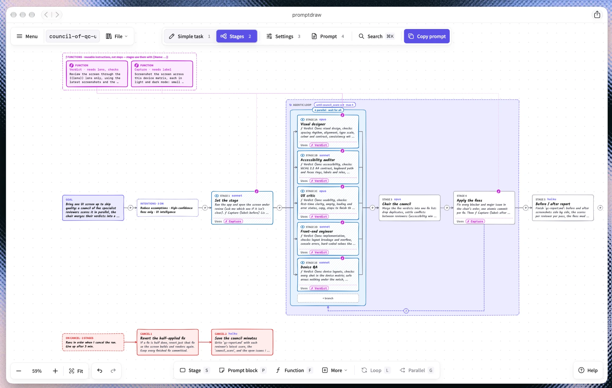
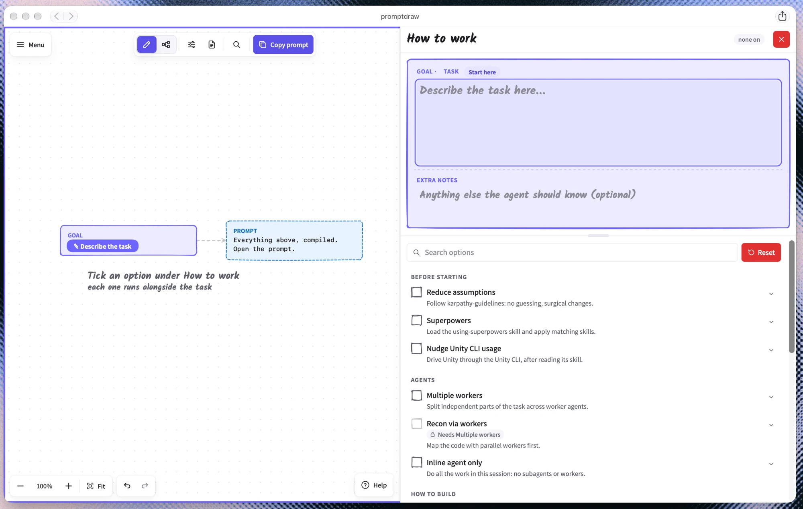

<div align="center">


# promptdraw

**Sketch your agent's workflow on a whiteboard, from a one-liner to a multi-stage pipeline with loops, parallel reviewers and A/B your workflows, then copy a ready-to-paste prompt, all in your browser with no account and no backend.**

**[▶ Try it live: aswinmurali-io.github.io/promptdraw](https://aswinmurali-io.github.io/promptdraw/)**

<a href="public/intro.mp4"></a>

<sub>▶ <a href="public/intro.mp4">Watch the 30-second intro (MP4)</a></sub>

[What it is](#-what-it-is) ·
[How it works](#-how-it-works) ·
[Features](#-features) ·
[Shortcuts](#-keyboard-shortcuts) ·
[Run it](#-run-it)



</div>

---

## ✨ What it is

Coding agents work better with a clear brief: what to build, how to work, when to stop and
what to report. promptdraw lets you put that brief together visually and copy it out as one
clean Markdown prompt.

Start simple by describing a task and ticking a few "how to work" options. When a job needs
more structure, switch to **Stages** and sketch the whole run: stages, reusable functions,
loops that repeat until a score is reached, parallel branches and clean-up steps for when you
cancel. The prompt updates live as you draw.

| | |
|---|---|
| 🖊️ **Hand-drawn** | Rough outlines, handwriting fonts and soft motion, in light and dark. |
| 🔒 **Private** | No server, no account, no telemetry. Your work lives in your browser. |
| ⚡ **Live** | Every edit shows up in the prompt straight away, with gaps flagged. |
| ⌨️ **Keyboard first** | A command palette and a shortcut for nearly everything. |
| 📱 **Anywhere** | Floating panels on laptops, a tab bar and pull-up sheet on phones, and a Windows desktop app. |

## 🧭 How it works

```text
  1  Describe the task   ->   2  Tick how the agent should work   ->   3  Copy the prompt
```

1. **Describe the task.** Type it into the Goal card (press `T` to jump there). Add any extra
   notes the agent should know.
2. **Tick how the agent should work.** The **How to work** panel holds the options. Every
   ticked option is drawn on the board as a card running alongside your task, flowing into
   the Prompt card.
3. **Copy the prompt.** Press **Copy prompt** (`Ctrl/Cmd+Enter`) and paste it into your agent.

On first load a welcome card walks you through it. Dismiss it with **Got it**; you can bring
the hints back from the menu.

## 🧩 Features

### Simple task

For everyday jobs: one task, a few options, one prompt.



- **Goal card and task board.** Your task is a card; each ticked option joins it in a
  parallel lane, and an option that builds on another follows it.
- **How to work.** Ready-made instructions, searchable and grouped by purpose. When
  an option needs another one first, it says so instead of silently failing.

  | Group | Options |
  |---|---|
  | Before starting | Reduce assumptions · Superpowers · Nudge Unity CLI usage |
  | Agents | Multiple workers · Recon via workers · Inline agent only |
  | How to build | High-confidence fixes only · UI intelligence · Mock iterations |
  | Checks | Tests matter · Test on Android emulator (CDP) · Basic code review · Review loop |
  | Report back | Progress reports · Basic dashboard · Push PR |

- **Settings.** Branch, base branch, worktree, copying env files, commit style and Unity
  options, each one a click on a segmented control.
- **Prompt panel.** See the prompt as a formatted **Preview** or raw **Markdown**. Anything
  still waiting for text is flagged, and one click takes you to the field that fills it.

### Stages

For bigger jobs: an infinite canvas for drawing a multi-step agent workflow.

- **Stages.** Each step has a name, instructions, a model (fable, opus, sonnet or haiku) and an
  optional read-only mode for steps that should only look, not change anything.
- **Prompt blocks.** Free text dropped between stages, for context or hand-off notes.
- **Functions.** Write an instruction once and reuse it anywhere with `[[Name: blank = value]]`,
  filling in its blanks per use. Every stage that uses one shows it on its card.
- **Agentic loops.** Wrap stages in a loop that repeats until a score is reached, with a pass
  limit so it always ends (for example *until council_score ≥ 8, max 4 passes*). Loops nest.
- **Parallel groups.** Run branches side by side and wait for all of them, like a council of
  reviewers working at once.
- **On cancel.** Stages that run, in order, if you stop the agent mid-run: revert a half-done
  fix, save notes, park the work on a branch.
- **Prompt flags.** Build one workflow with A/B variants. Declare on/off or text flags, show a
  block only `when` a flag is set, or branch inside text with `{{#if flag}}…{{else}}…{{/if}}`.
  Forks show as A/B lanes on the canvas; click a lane's tag or use the **Flags** tool to
  switch. Copy just the chosen variant, or embed both with labels.
- **Inspector.** Docked on the right, with every field of the selected card. Prompts open in
  a roomy editor with a Preview and an expand dialog.
- **Workflow library.** Save workflows in the browser, reopen them, and get a warning before
  you overwrite or lose unsaved changes. Export any workflow as YAML.
- **Starter workflows.** Open one from *File ▾ → Templates*, or from the **Demo workflows**
  island on a blank board:

  | Starter | What it shows |
  |---|---|
  | **Sprint Chaser** | A backlog, a plan and a nested pick → build ∥ tests → verify loop. |
  | **Council of QC UI** | A device matrix capture, then parallel read-only reviewers. |
  | **The Holy Audit of Engineer** | An audit of every practice, fixing what is safe. |

- **Smooth navigation.** Pan, pinch or wheel zoom, Fit to screen, and a gliding intro that
  shows the whole flow before settling into the home view.

### Everywhere

- 🎬 **Intro video.** A first visit opens a 30-second tour of the app; *Menu → Watch the intro
  video* plays it again.
- 🎙️ **Dictation.** Every prompt field has a mic that types what you say, using your
  browser's speech recognition.
- 🔎 **Command palette** (`Ctrl/Cmd+K`) with fuzzy search and recent commands first.
- ↩️ **Undo and redo** with typing merged into sensible steps.
- 🌗 **Light, dark or system** theme (`Alt+Shift+D`).
- 💾 **Files.** Save settings as JSON, export a workflow as YAML, or export the prompt as
  Markdown. Open or drop files onto the canvas to load them.
- ♿ **Accessible.** Focus-trapped dialogs, screen-reader labels on the board and reduced
  motion respected throughout.

## ⌨️ Keyboard shortcuts

Press `?` in the app for the full list. The essentials:

| Keys | Action |
|---|---|
| `Ctrl/Cmd + K` | Command palette |
| `Ctrl/Cmd + Enter` | Copy prompt |
| `T` | Edit task |
| `1` / `2` | Simple task / Stages |
| `3` / `4` | Toggle Settings / Prompt panel |
| `Ctrl/Cmd + O` | Open a file |
| `Ctrl/Cmd + S` | Save (the workflow on the Stages tab) |
| `Ctrl/Cmd + Shift + S` | Export workflow as YAML |
| `Ctrl/Cmd + Shift + E` | Export prompt as Markdown |
| `Ctrl/Cmd + Z` / `Shift + Z` | Undo / redo |
| `Ctrl/Cmd + =` / `-` / `0` | Zoom in / out / reset |
| `Alt + Shift + D` | Cycle theme |

On the Stages tab:

| Keys | Action |
|---|---|
| `S` / `P` / `F` | Add a stage / prompt block / function block |
| `L` / `G` | Loop / run in parallel the selected blocks |
| `Shift + 1` | Zoom to fit |
| `Alt + Arrows` | Move the focused block |
| `Ctrl/Cmd + A` | Select all blocks |
| `Delete` | Delete the focused block |
| `Esc` | Clear selection, then close the inspector |

Bare-key shortcuts never fire while you are typing in a field.

## 🚀 Run it

Requires Node 20 or later.

```bash
npm install
npm run dev            # http://localhost:5173
```

- **Host it.** `npm run build` writes a plain static site to `dist/`. Upload it to GitHub
  Pages, Netlify, Vercel, Cloudflare Pages or any static host; it works at a domain root or
  under a sub-path.
- **Desktop app.** `npm run package:win` builds a single portable Windows exe in `release/`.

Your data stays in the browser (or the desktop app) you use it in. To move it elsewhere,
save your settings as JSON and your workflows as YAML, then open them on the other side.

Working on promptdraw itself? `CLAUDE.md` and `lat.md/` hold the conventions and design notes.

Want an AI agent to write workflows for you? The [`promptdraw` skill](.claude/skills/promptdraw/SKILL.md)
teaches Claude Code (and other agents that read skills) to write and validate Stages-tab YAML
directly, then open it in the app.

## 🙏 Credits

Design inspired by open-source whiteboard tools. promptdraw is an original app; see
[THIRD_PARTY_NOTICES.md](THIRD_PARTY_NOTICES.md) for the fonts and libraries it ships.

## 📄 License

promptdraw is licensed under the [GNU Affero General Public License v3.0](LICENSE)
(`AGPL-3.0-only`). You may use, modify and share it, but any version you distribute, or let
people use over a network, must make its full source available under the same licence.
